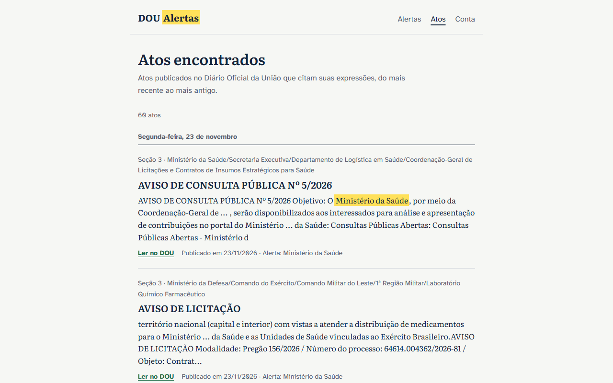
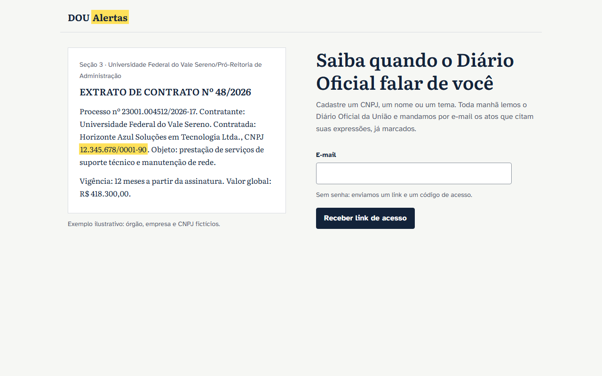
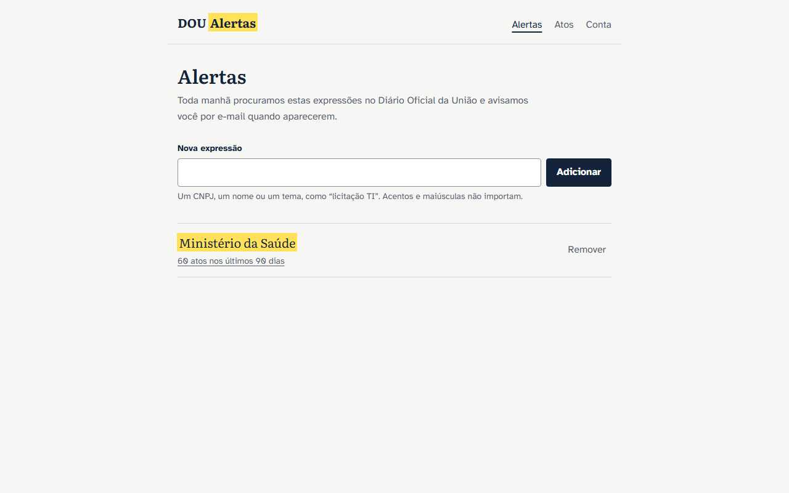
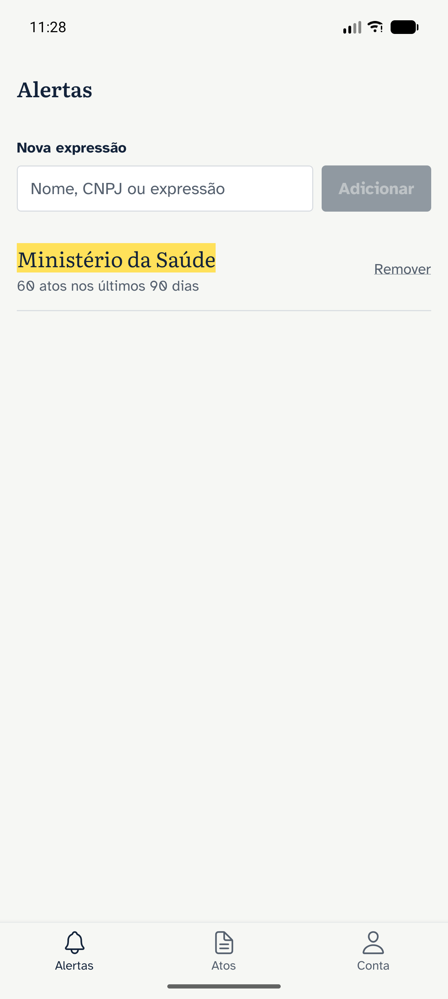
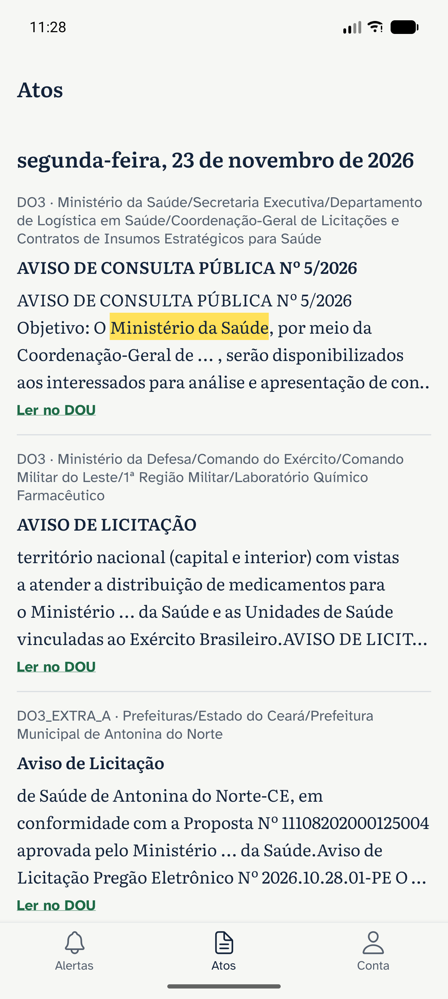
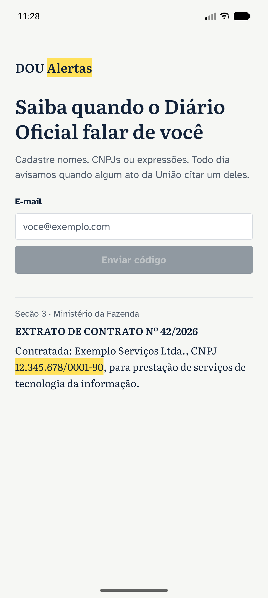

# dou-alerts

Alertas diários do Diário Oficial da União para CNPJs, nomes e temas — web e app.

Save a keyword (a CNPJ, a person or company name, a topic phrase). Every morning a job searches the
[Diário Oficial da União](https://www.in.gov.br/consulta) (DOU, Brazil's federal official gazette),
records new matches, and sends you an email digest plus a push notification with a link to each act.

A small full-stack portfolio project: Next.js + Postgres on the web, Expo (React Native) on mobile,
one shared TypeScript core.

**Live:** https://dou-alerts.vercel.app (sign in with any email; the daily job runs at 08:00 Brasília).

## Screenshots

**Web**



| Login | Alerts |
| --- | --- |
|  |  |

**Mobile**

| Alerts | Matches | Login |
| --- | --- | --- |
|  |  |  |

(Android emulator. UI copy is in Portuguese because the DOU is Brazilian; code and docs are English.)

## Architecture

```
Vercel cron (08:00 America/Sao_Paulo)
      |
      v
/api/cron/daily  --->  DOU search (in.gov.br, serial, >=1 s apart)
      |
      v
  Postgres (Neon)  --->  Resend (email digest)
                    \->  Expo push service (push)

web (Next.js)  --\
                  >--  JSON API (/api/*, Better Auth)  --->  Postgres
mobile (Expo)  --/
```

- `packages/core` - pure TypeScript: DOU search client and parser, phrase normalisation, digest building.
- `apps/web` - Next.js App Router: pages, JSON API, Better Auth, cron route, Drizzle schema and migrations.
- `apps/mobile` - Expo app (expo-router) using the same API.

## How matching works

- One alert = one exact phrase. The phrase is sent to the DOU search **quoted**, so it is an
  exact-phrase match (unquoted search is loose token matching and useless for CNPJs).
- A phrase of exactly 14 digits (with or without punctuation) is auto-formatted to `XX.XXX.XXX/XXXX-XX`,
  the only form the DOU indexes.
- The job searches `exactDate=dia` (the current Brasilia date), follows the DOU's keyset paging,
  reads at most 3 pages (60 acts) per phrase and stops early on a short page.
- DOU requests are serialised with at least 1 s between them; each has a 30 s timeout and one retry.
  A failing phrase is logged and skipped, not fatal.
- Each act notifies once per alert. If sending fails, the match stays un-notified and is retried next run.
- Phrases are processed least-recently-checked first, so a run cut short by the time budget does not
  starve the same phrases every day. The job stops starting new phrases after ~100 s (a single phrase can take
  ~3 min in the worst case, and the route's `maxDuration` is 300 s). Overlapping runs are prevented by a Postgres
  advisory lock.
- **Retention: 90 days.** Older matches, and acts no longer referenced, are deleted by the daily job.
  Account deletion cascades everything.

Login is passwordless. One email carries both a magic link and a 6-digit code on web; mobile is code-only.

## Limitations

- Acts published in an extra edition after the 08:00 run are not picked up, and a missed cron day is not backfilled.
- Sign-up is open to anyone with an email address.
- Push needs an EAS `projectId` (an Expo account); without it the app skips push registration.
- Building the Android app natively on Windows needs a short checkout path or a hoisted install, because of path-length limits.
- Max 10 alerts per user, no boolean queries.

## Local setup

Requirements: Node 22+, pnpm 12 (see `packageManager`), Docker.

```sh
pnpm install
docker compose -f apps/web/docker-compose.yml up -d   # Postgres 17 on localhost:5433
cp .env.example apps/web/.env.local                    # then fill in the values below
pnpm --filter web db:migrate                           # needs DATABASE_URL in the environment
pnpm --filter web dev
```

Without `RESEND_API_KEY`, outside production, emails are printed to the server log instead of sent,
so you can log in with the code from the log.

Trigger the daily job by hand:

```sh
curl -H "Authorization: Bearer $CRON_SECRET" http://localhost:3000/api/cron/daily
```

Mobile (set `EXPO_PUBLIC_API_URL` to your web server, default `http://10.0.2.2:3000` for the Android emulator):

```sh
pnpm --filter mobile android
```

## Environment variables

| Variable | Purpose |
| --- | --- |
| `DATABASE_URL` | Postgres connection string |
| `BETTER_AUTH_SECRET` | Better Auth signing secret (random string) |
| `BETTER_AUTH_URL` | Public base URL of the web app |
| `RESEND_API_KEY` | Resend API key; unset in dev = log emails |
| `EMAIL_FROM` | Sender, e.g. `DOU Alertas <alertas@your-domain.example>` |
| `CRON_SECRET` | Bearer token the cron route requires |
| `EXPO_ACCESS_TOKEN` | Optional Expo push access token |
| `EXPO_PUBLIC_API_URL` | Mobile only: API base URL |

## Tests

```sh
pnpm -r lint && pnpm -r typecheck
pnpm -r test    # web tests need the Docker Postgres above; migrations run in the vitest global setup
```

Note: `pnpm test` uses a separate `dou_alerts_test` database on the same Postgres (created automatically), so the dev database is left alone.

- `packages/core`: parser (saved DOU HTML fixture), normalisation, digest, search paging.
- `apps/web`: auth, API routes and the daily job, against a real Postgres with an injected fetch.
- `apps/mobile`: type-check plus a light component test.
- CI (GitHub Actions) runs lint, type-check, tests with a Postgres service, and `next build`. It never calls the live DOU.

A manual run against the real DOU is recorded in [docs/e2e.md](docs/e2e.md).

## Deploy notes

- Web: Vercel, project root `apps/web`, functions pinned to `gru1` (São Paulo), next to the database and to
  in.gov.br. `apps/web/vercel.json` schedules the cron at `0 11 * * *` UTC (08:00 Brasília). Set the env vars
  above in the project (`ENABLE_EXPERIMENTAL_COREPACK=1` so Vercel uses the pinned pnpm).
- Database: Neon free Postgres in `aws-sa-east-1`; the app uses the pooled connection string, migrations use
  the direct one: `DATABASE_URL=<direct url> pnpm --filter web db:migrate`.
- in.gov.br refuses connections from VPN exit IPs; Vercel's `gru1` and `iad1` regions reach it fine.
- Email: Resend with a verified sending domain; set `EMAIL_FROM` to an address on it.
- Mobile: point `EXPO_PUBLIC_API_URL` at the deployed web URL and add an EAS `projectId` to enable push.

## Credits

The DOU result parser and HTML stripping are adapted from
`mcp-brasil` (MIT, same author).

## License

MIT, see [LICENSE](LICENSE).
